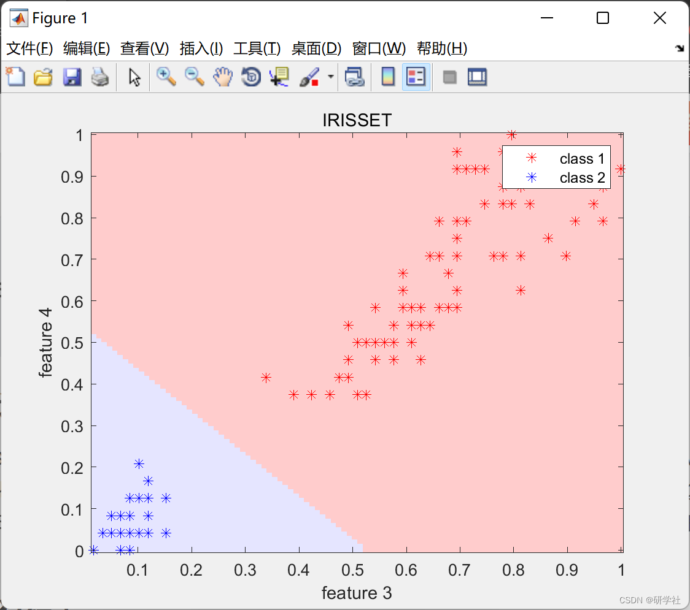
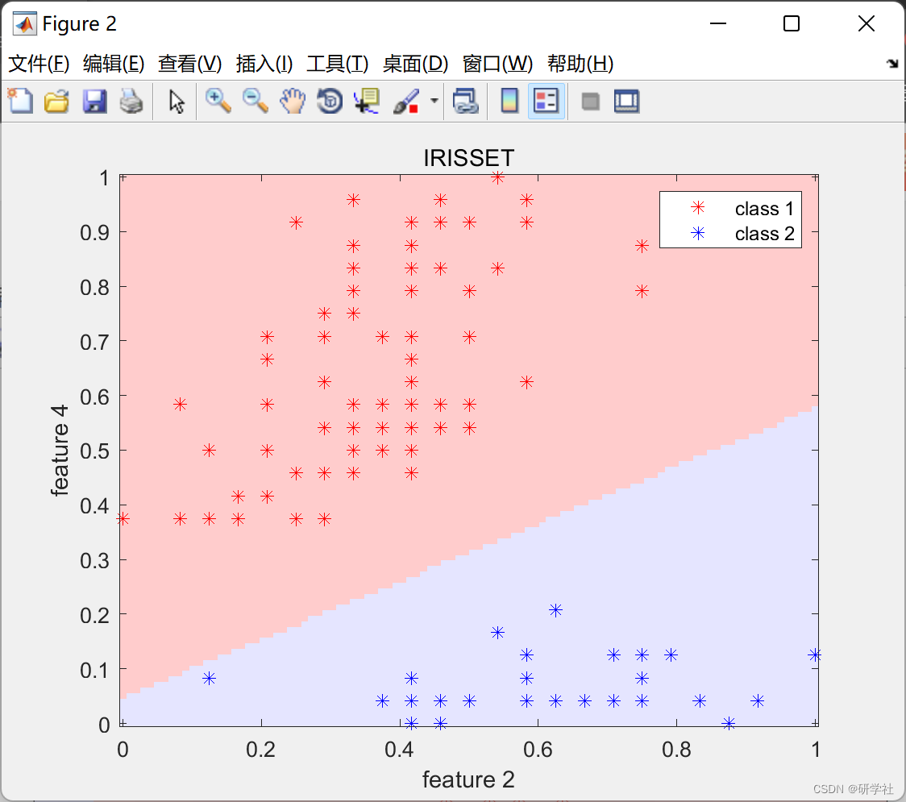
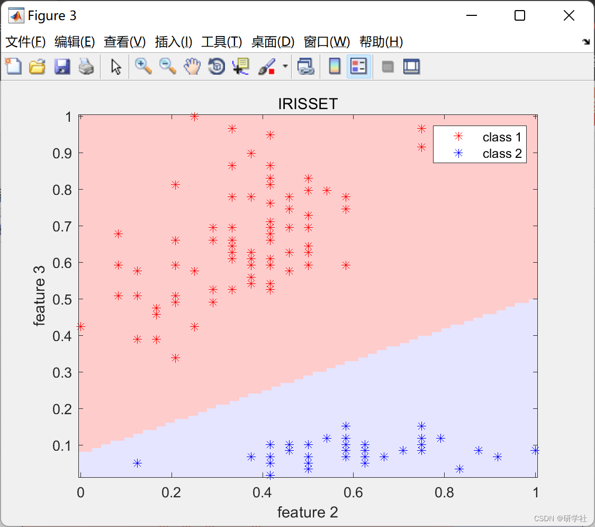
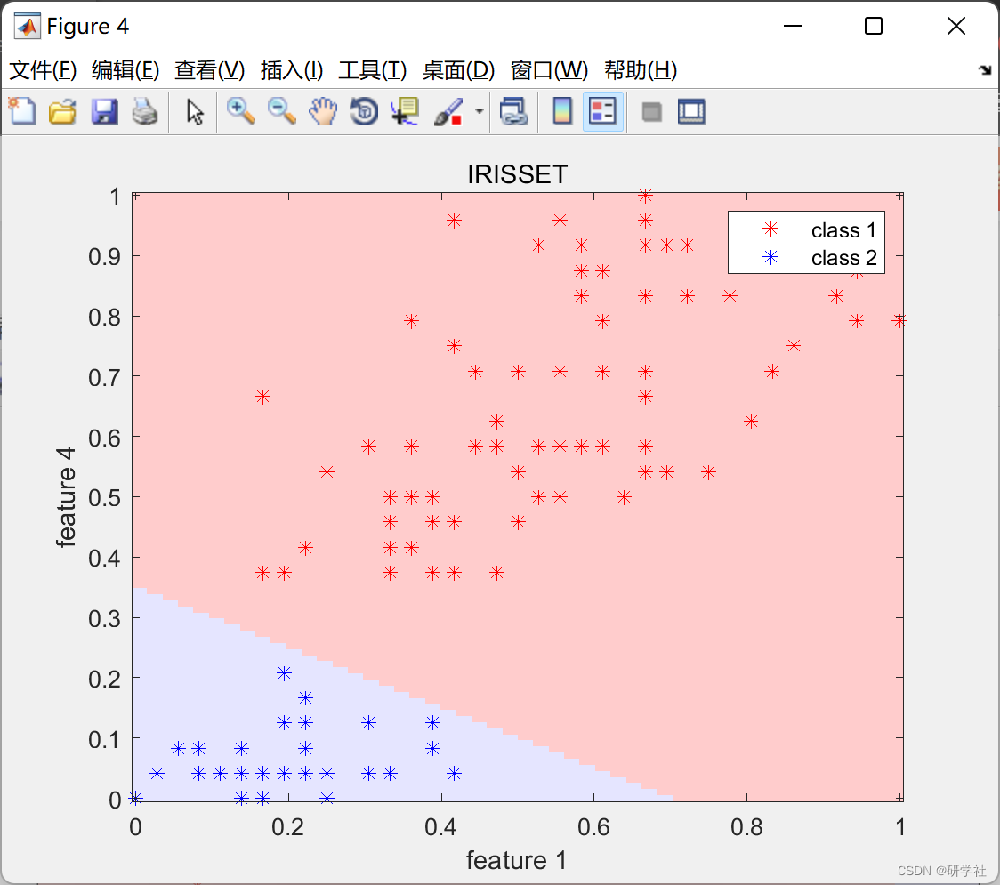
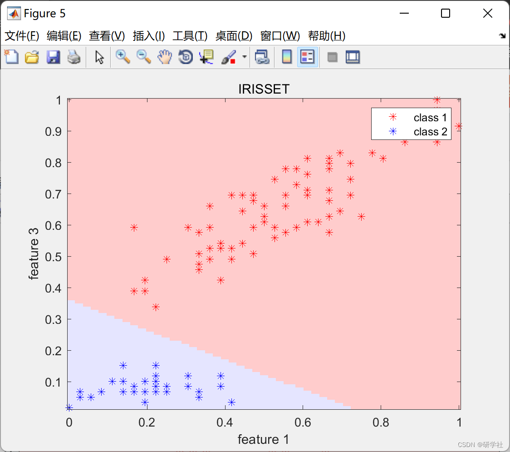
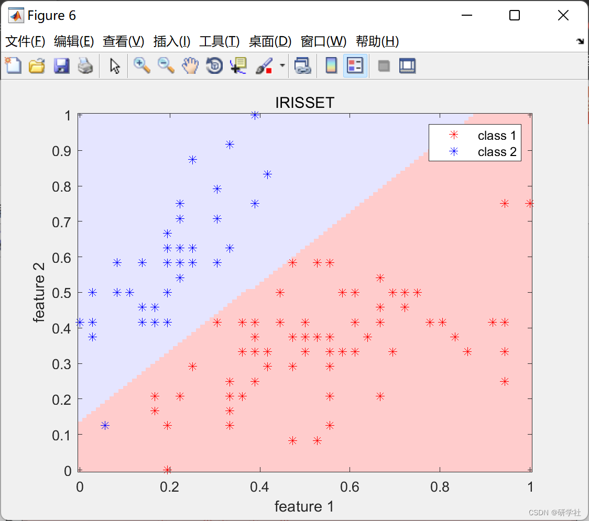

# LSSVM Clustering Research (Matlab Code Implementation)

🏆 Bloggers' Advantage: 🌞🌞🌞 The content of the blog is assiduously thought-provoking and logically clear to facilitate readers.
⛳️ Mantra: "A journey of a thousand miles begins with a single step."
💥1 Overview: In recent years, Suykens et al. proposed a new SVM method called LSSVM, which transforms the learning problem of SVM into solving linear equations, significantly reducing the computational complexity brought about by solving constrained quadratic programming in SVM. The numerical stability and capacity control strategy of LSSVM enable the kernel function matrix to achieve good results even when it is not positive definite.
📚2 Running Results
​Edit
​Edit
​Edit
​Edit
​Edit
​Edit
Some code:
%% dataset loop
for i = 1:length(dataset_names)
    dataset_name = dataset_names{i};
    load(sprintf('../dataset/classification/%s.mat', dataset_name))
%% experiment loop
for j = 1:n_repetition
    %% load/shuffle/divide/normalize dataset
    data = dataset(i);
    combinations = combnk(1:size(data.x_train,2),2);
    for k = 1:size(combinations,1)
        % get patterns with two attributes
x_train = data.x_train(:,combinations(k,:));  
%% train  
[~,y_train_n] = max(data.y_train,[],2);  
y_train_n(y_train_n==2) = -1;  
params = cross_lssvm(x_train, y_train_n, params);  
model = lssvm_train(x_train, y_train_n, params);  
%% plot decision surface  
x_min = min(x_train);  
x_max = max(x_train);  
[x, y] = meshgrid(linspace(x_min(1), x_max(1)), linspace(x_min(2),x_max(2)));  
image_size = size(x);  
xy = [x(:) y(:)];  
y_hat = lssvm_predict(xy, model);  
decisionmap = reshape(y_hat, image_size);  
figure,  
img = imagesc([x_min(1) x_max(1)],[x_min(2) x_max(2)],decisionmap);  
hold on;  
set(gca,'ydir','normal');  
cmap = [1 0.8 0.8; 0.95 1 0.95; 0.9 0.9 1];%clc  
colormap(cmap);  
[~,y_test_n] = max(data.y_train,[],2);  
plot(x_train(y_test_n == 2, 1),x_train(y_test_n == 2, 2),'r*');  
plot(x_train(y_test_n == 1, 1),x_train(y_test_n == 1, 2),'b*');  
legend({'class 1', 'class 2', 'class 3'});  
title(upper(dataset_names{i}));  
xlabel(sprintf('feature %d', combinations(k,1)));  
ylabel(sprintf('feature %d', combinations(k,2)));  
hold off;  
end  
end  
end  
🎉3 References
🌈4 Matlab code implementation

## Images

<!-- PAYMENT_BLOCK -->

## Get this dataset

- Payment link (Stripe): [Buy now](https://buy.stripe.com/3cs8yP7sY87d0vu9AB)
- Payment QR code: 

<!-- /PAYMENT_BLOCK -->
